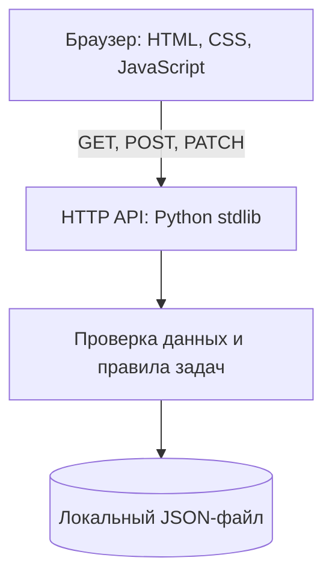

# Архитектура

## Компоненты



## API

| Метод | Путь | Назначение |
| --- | --- | --- |
| `GET` | `/api/tasks` | Получить задачи, отсортированные по сроку и приоритету |
| `POST` | `/api/tasks` | Создать задачу |
| `PATCH` | `/api/tasks/{id}` | Изменить статус |

Пример тела для создания задачи:

```json
{
  "title": "Подготовить показ",
  "due_date": "2027-02-10",
  "priority": "high",
  "team": "Web",
  "description": "Показать доску и прогон тестов"
}
```

## Модель данных

```text
Task = { id, title, description, due_date, priority, team, status }
```

Идентификатор генерируется приложением. Допустимые статусы: `backlog`, `in_progress`, `done`.

## Формула приоритета

Для учебного планирования используем относительную оценку:

`Score = (Impact × Urgency) / Effort`

Каждая величина оценивается от 1 до 5. Чем выше результат, тем раньше команда обсуждает задачу. Это ориентир для обсуждения, а не автоматическое обещание срока.
